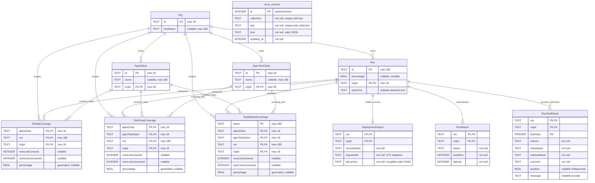

# Database schema — version 5

Eleven tables: the seven SFCC tables, local_records, DeploymentImport, RunReport, and RunTestResult. PK marks each component of a primary key. FK includes orgId when referring to Run or an org-scoped class. Test outcomes keep class-name snapshots; they do not imply per-test coverage attribution.

Coverage percentage is generated for the three coverage tables; Run.percentage is a weighted stored aggregate. All relational tables use STRICT and WITHOUT ROWID. local_records uses its autoincrement integer key.

Run history additionally uses Run_org_date on (orgId, COALESCE(startTime, ''), id). RunReport and RunTestResult are indexed by their primary keys for scoped run and outcome retrieval. Existing SFCC foreign-key and coverage indexes are unchanged. See [SFCC model](sfcc-model.md) for the original seven tables and [org import](org-import.md) for current import and migration behavior.

Migration 5 adds TestClassCoverage_drilldown (orgId, run, apexClass, apexTestClass), TestMethodCoverage_drilldown (orgId, run, apexClass, apexTestClass, name), and RunTestResult_class_method (orgId, run, classId, methodName). No tables or columns were added.
